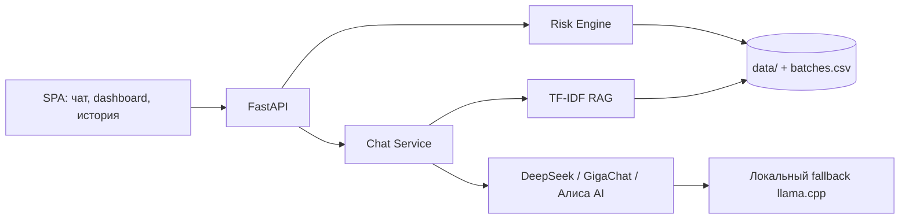

# Симулякрум — контроль риска партий пищевой продукции

Учебный веб-сервис **«Симулякрум»** для кейса **«ИИ для контроля качества пищевой продукции»**. Система оценивает
риск партии безалкогольного напитка по условиям хранения и перевозки, сроку годности и
лабораторным показателям, присваивает уровень риска, предлагает действие и объясняет решение.

> **Важно.** Данные предоставлены для учебной демонстрации. Оценки не могут использоваться для
> реальных решений о безопасности продукции без экспертизы специалистов.

## Что умеет

- Оценивает партию по трём уровням: **низкий / средний / высокий**, выдаёт рекомендованное действие.
- Показывает факторы риска с весами и пояснениями, а также числовую оценку 0–100.
- Комбинирует **логические правила** (жёсткие ограничения) и **дерево решений** (`DecisionTreeClassifier`).
- Генерирует понятное объяснение через **DeepSeek**, **GigaChat**, **Алису AI**
  (Yandex AI Studio) или локальный fallback.
- Содержит электронную карточку партии, историю проверок с поиском/фильтрами/пагинацией и форму ручной проверки.
- Показывает статистику и распределение партий по уровням риска.
- **Интерфейс в тёмной теме** с четырьмя экранами: чат с ИИ-агентом, панель администратора, история и уведомления.
- **Чат-агент с RAG**: ищет релевантные партии, поставщиков, сценарии и нормативы в данных,
  передаёт найденные факты LLM; таблицы показывает для статистики или по запросу, графики и
  шкалы — только по явному маркеру.
- Отдаёт нормализованный CSV, отчёты по партиям и документацию OpenAPI (`/docs`).

## Архитектура



## Интерфейс

Приложение — SPA в тёмной теме с четырьмя экранами:

- **Чат с ИИ-агентом** — список агентов, диалог, сводка по запросу, системные логи и виджеты.
- **Панель администратора** — KPI, динамика брака, распределение статусов, топ причин и карточка риска.
- **История** — фильтры по периоду/статусу, поиск по партии и оператору, пагинация.
- **Уведомления** — критические события, предупреждения, системные сообщения, отметки о прочтении.

## Чат-агент

Слева сверху можно выбрать одного из трёх агентов:

- **DeepSeek** — облачная модель `deepseek-chat` через `DEEPSEEK_API_KEY`.
- **GigaChat** — облачная модель через `GIGACHAT_CREDENTIALS`.
- **Алиса AI** — модель Yandex AI Studio через `ALICE_AI_API_KEY` и `ALICE_AI_FOLDER_ID`.

Если выбранный облачный агент недоступен, запрос переходит к следующему доступному
провайдеру, затем — к локальной `Vikhr-Qwen-2.5-1.5B-Instruct` и Risk Engine.
RAG-поиск по 1500 партиям, сценариям, поставщикам и нормативам выполняется до обращения к LLM.

Графики, диаграммы и шкалы строятся только по запросу пользователя; таблицы — по запросу
или для статистических вопросов:

- «покажи динамику брака (график)» — плавный график с градиентной заливкой;
- «покажи распределение статусов (диаграмма)» — donut-диаграмма;
- «покажи партию RE-2025-001 (виджет)» — шкала риска;
- «топ-5 партий по свинцу (график)» — таблица и график.

По умолчанию агент отвечает **только текстом**: таблицы и статус-чипы скрыты, графиков и шкал нет.
Таблицы автоматически появляются для статистических вопросов («статистика», «распределение»,
«топ», «сравни», «динамика», «сколько» и т.п.). Чтобы получить детали вручную, добавьте
`(таблица)`, `(график)`, `(диаграмма)`, `(список)` или `(виджет)`.

Поддерживаются рейтинги поставщиков: «топ-10 поставщиков по риску», «какой поставщик лучший»,
«у какого поставщика больше всего брака».

Поддерживаются вопросы о статистике, сценариях, поставщиках, показателях, нормах, действиях,
методологии, LLM, источниках данных, отдельных партиях, топ-списках и демо-примерах, а также
сценарии «что если» и рекомендации по снижению риска. Запросы не по теме и попытки получить
пароли, ключи, переменные окружения или системные инструкции блокируются.

## Быстрый старт

```powershell
python -m venv .venv
.\.venv\Scripts\Activate.ps1
pip install -r requirements.txt
pip install -r requirements-llm.txt
python scripts/download_local_llm.py
Copy-Item .env.example .env
uvicorn app.main:app --reload --port 8000
```

Откройте <http://127.0.0.1:8000>. Документация API — <http://127.0.0.1:8000/docs>.

Приложение читает все CSV/XLSX из папки `data/`, объединяет пять сценариев и удаляет дубликаты.
Нормализованный набор также можно пересобрать в `batches.csv` командой
`python -m app.data_loader`.

## Docker

В репозитории есть `Dockerfile` для CPU-запуска. В образ не включаются `.env` и папка `models/`:
ключи передаются через `--env-file`, локальная модель — через volume.

```powershell
docker build -t simulyakrum-food-risk:latest .
docker run --rm -p 8000:8000 --env-file .env simulyakrum-food-risk:latest
```

С локальным fallback (GGUF-модель лежит в `models/` на хосте):

```powershell
docker run --rm -p 8000:8000 --env-file .env `
  -e USE_LOCAL_LLM=true `
  -v "${PWD}\models:/app/models" `
  simulyakrum-food-risk:latest
```

В Dockerfile по умолчанию `USE_LOCAL_LLM=false`, чтобы образ запускался без модели.
Для local fallback смонтируйте `models/` и включите переменную.

## Стек

- Python 3.13, FastAPI, Uvicorn, Pydantic
- pandas, NumPy, scikit-learn (`DecisionTreeClassifier`)
- Vanilla HTML/CSS/JS, SVG-графики без внешних chart-библиотек
- DeepSeek API, GigaChat SDK, Yandex AI Studio
- llama.cpp + GGUF `Vikhr-Qwen-2.5-1.5B-Instruct` для локального fallback
- TF-IDF RAG по данным проекта

### LLM

```powershell
pip install -r requirements-llm.txt
python scripts/download_local_llm.py
```

1. **DeepSeek** — укажите `DEEPSEEK_API_KEY` в `.env`.
2. **GigaChat** — укажите `GIGACHAT_CREDENTIALS` в `.env`.
3. **Алиса AI** — укажите `ALICE_AI_API_KEY`, `ALICE_AI_FOLDER_ID` и при необходимости
   `ALICE_AI_MODEL` / `ALICE_AI_MODEL_URI` в `.env`.
4. **Локальный fallback** — `Vikhr-Qwen-2.5-1.5B-Instruct` в `models/` через llama.cpp.
5. **Rule-based** — используется автоматически, если все LLM недоступны.

Цепочка деградации: `DeepSeek → Алиса AI → GigaChat → локальная модель → rule-based`.

## Переменные окружения

| Переменная | По умолчанию | Назначение |
|---|---|---|
| `GIGACHAT_CREDENTIALS` | — | Base64-ключ авторизации GigaChat |
| `GIGACHAT_SCOPE` | `GIGACHAT_API_PERS` | Scope API GigaChat |
| `GIGACHAT_MODEL` | `GigaChat` | Имя модели |
| `GIGACHAT_VERIFY_SSL` | `true` | Проверка SSL-сертификатов |
| `GIGACHAT_TIMEOUT` | `60` | Таймаут запроса, секунды |
| `DISABLE_GIGACHAT` | `false` | Принудительно отключить GigaChat |
| `DEEPSEEK_API_KEY` | — | API-ключ DeepSeek |
| `DEEPSEEK_MODEL` | `deepseek-chat` | Имя модели DeepSeek |
| `DEEPSEEK_BASE_URL` | `https://api.deepseek.com` | Базовый URL API |
| `DEEPSEEK_TIMEOUT` | `60` | Таймаут запроса, секунды |
| `DEEPSEEK_MAX_TOKENS` | `2000` | Лимит ответа DeepSeek с учётом reasoning |
| `DISABLE_DEEPSEEK` | `false` | Принудительно отключить DeepSeek |
| `ALICE_AI_API_KEY` | — | API-ключ Yandex AI Studio для Алисы AI |
| `ALICE_AI_FOLDER_ID` | — | Folder ID каталога Yandex Cloud |
| `ALICE_AI_MODEL` | `yandexgpt` | Идентификатор модели Yandex AI Studio |
| `ALICE_AI_MODEL_URI` | — | Полный URI модели, например `gpt://folder/aliceai` |
| `ALICE_AI_API_STYLE` | `yandex` | `yandex` или `openai` |
| `ALICE_AI_BASE_URL` | `https://llm.api.cloud.yandex.net/foundationModels/v1` | Базовый URL |
| `ALICE_AI_TIMEOUT` | `60` | Таймаут запроса, секунды |
| `DISABLE_ALICE_AI` | `false` | Принудительно отключить Алису AI |
| `USE_LOCAL_LLM` | `true` | Включить локальный fallback |
| `LOCAL_LLM_MODEL` | `models/Vikhr-Qwen-2.5-1.5B-Instruct` | Путь/имя transformers-модели |
| `LOCAL_LLM_GGUF` | `models/Vikhr-Qwen-2.5-1.5B-GGUF/...Q4_K_M.gguf` | Путь к GGUF для llama.cpp |
| `LOCAL_LLM_THREADS` | число CPU-ядер | Потоки CPU для локальной модели |
| `LOCAL_LLM_MAX_TOKENS` | `180` | Лимит генерации локальной модели |
| `LOCAL_LLM_CONTEXT_CHARS` | `600` | Сколько символов RAG-контекста видит локальная модель |
| `DATA_DIR` | `data/` | Папка с исходными CSV/XLSX |
| `REFERENCE_DATE` | максимальная дата выпуска в наборе | Опорная дата расчёта срока годности |

> `GIGACHAT_CREDENTIALS` — именно Base64 от `client_id:client_secret`, а `GIGACHAT_SCOPE` —
> `GIGACHAT_API_PERS`/`GIGACHAT_API_CORP`. У Алисы AI `ALICE_AI_API_KEY` — длинный ключ,
> `ALICE_AI_FOLDER_ID` — короткий folder id каталога. Код умеет автоматически исправлять
> перепутанные поля, но лучше хранить их в правильном порядке.

## Логика оценки

### Жёсткие правила (критические факторы)

| Условие | Уровень |
|---|---|
| Истёк срок годности | высокий |
| Температура хранения или перевозки вне 0–18 °C | высокий |
| Заключение лаборатории «Опасно» | высокий |
| Заключение лаборатории «Брак» / «Не соответствует» | высокий |
| Свинец > 0.05 мг/кг | высокий |
| БГКП > 0 | высокий |
| КМАФАнМ > 150 КОЕ/см³ | высокий |

Партия с любым из этих нарушений **никогда** не попадает в низкий риск.

### Пограничные и информационные факторы

| Условие | Вес |
|---|---|
| Срок годности истекает в ближайшие 2 дня | 30 |
| Кислотность > 2.5 см³ | 30 |
| CO₂ вне 0.4–0.6% | 20–25 |
| Дрожжи > 10 КОЕ/см³ | 15–20 |
| Плесень > 6 КОЕ/см³ | 15–20 |
| КМАФАнМ > 50 КОЕ/см³ | 10 |
| Кадмий/мышьяк выше безопасного уровня | 20 |
| Условно годная партия / требуется проверка | 15 |

Веса суммируются в оценку 0–100. Порог среднего риска — 15, высокого — 70 (либо наличие
критического фактора). Действия: `допустить к реализации` / `направить на дополнительную проверку` /
`временно изолировать партию`.

### Дерево решений

При старте `RiskEngine` обучает `DecisionTreeClassifier` (`max_depth=6`, `random_state=42`) на
1500 партиях. Признаки: температуры хранения и перевозки, сухие вещества, кислотность, CO₂,
свинец, кадмий, мышьяк, КМАФАнМ, БГКП, дрожжи, плесень. Срок годности обрабатывается правилами,
чтобы дерево не переобучалось на даты выпуска сценариев.

Правила остаются приоритетными. Дерево показывается в карточке как «второе мнение» с уверенностью
и отметкой о расхождении, если оно есть.

## Данные

В папке `data/` лежат пять сценариев в форматах CSV и XLSX (всего 10 файлов, 1500 уникальных
партий по 300 в каждом сценарии):

| Сценарий | Уровень риска | Что показывает |
|---|---|---|
| Идеальная партия | низкий | все показатели в норме |
| Риск поставщика | средний | повышенные дрожжи, плесень, КМАФАнМ |
| Технический сбой | средний | CO₂ вне рабочего диапазона |
| Технологический брак | высокий | повышенная кислотность и отклонение CO₂ |
| Опасный брак | высокий | тяжёлые металлы и микробиология |

Показатели: сухие вещества, кислотность, CO₂, свинец, кадмий, мышьяк, КМАФАнМ, БГКП,
дрожжи, плесень, температура хранения и перевозки, срок годности и заключение лаборатории.

Загрузчик определяет формат по сигнатуре файла, поэтому корректно читает и XLSX-файлы, внутри
которых лежит CSV-текст. Дубликаты CSV/XLSX-копий удаляются, конфликтов в текущем наборе — 0.
Пересборка нормализованного файла:

```powershell
python -m app.data_loader --output batches.csv
```

Опорная дата оценки по умолчанию — максимальная дата выпуска в наборе (2025-05-05), поэтому
демо-примеры не «просрочиваются» со временем. Чтобы оценивать относительно текущей даты, задайте
`REFERENCE_DATE` в `.env`.

## API

| Метод | Путь | Описание |
|---|---|---|
| `GET` | `/` | Веб-интерфейс |
| `GET` | `/api/health` | Статус, провайдер LLM, размер набора, модель |
| `GET` | `/api/meta` | Поставщики, продукты, нормы, метаданные модели |
| `GET` | `/api/stats` | Статистика и распределение по уровням риска |
| `GET` | `/api/dashboard` | KPI, динамика по дням, статусы, топ причин, последняя рисковая партия |
| `GET` | `/api/batches` | Реестр/история: `limit`, `offset`, `risk_level`, `search`, `supplier`, `scenario`, `date_from`, `date_to`, `sort` |
| `GET` | `/api/batches/{batch_id}` | Карточка партии; `explain=true` добавляет LLM-объяснение |
| `GET` | `/api/batches/{batch_id}/report` | Текстовый отчёт по партии |
| `GET` | `/api/examples` | 5+ примеров; параметры `low`, `medium`, `high` |
| `POST` | `/api/predict` | Ручная оценка партии |
| `POST` | `/api/chat` | Чат-агент: текст, по запросу — таблицы/списки/графики/шкалы |
| `GET` | `/api/agents` | Доступные агенты и их статус |
| `GET` | `/api/notifications` | Уведомления и число непрочитанных |
| `POST` | `/api/notifications/read` | Отметить уведомления прочитанными |
| `POST` | `/api/notify` | Уведомить команду по партии |
| `GET` | `/api/export.csv` | Нормализованный объединённый набор |
| `GET` | `/docs` | Swagger UI |

Пример ручной оценки:

```json
{
  "batch_id": "MANUAL-0001",
  "product_type": "безалкогольный напиток",
  "supplier": "Ручной ввод",
  "production_date": "2025-05-01",
  "expiry_date": "2026-05-01",
  "storage_temp_c": 9.0,
  "transport_temp_c": 9.0,
  "dry_matter_pct": 10.0,
  "acidity_cm3": 2.1,
  "co2_mass_pct": 0.5,
  "lead_mg_kg": 0.002,
  "cadmium_mg_kg": 0.001,
  "arsenic_mg_kg": 0.0015,
  "kmafanm_cfu_cm3": 15,
  "bgkp_cfu_cm3": 0,
  "yeast_cfu_cm3": 5,
  "mold_cfu_cm3": 2,
  "lab_conclusion": "Соответствует",
  "use_llm": true
}
```

Ответ содержит `risk_level`, `risk_score`, `recommended_action`, `factors`, `parameters`,
`explanation`, `hard_violations`, `model` и (при `use_llm=true`) `explanation_llm`.

Пример запроса к чат-боту:

```json
{ "message": "Построй линейный график динамики брака", "agent": "deepseek" }
```

Ответ содержит `answer`, массив `blocks` (`text`, `list`, `table`, `chart`, `gauge`),
`suggestions`, `provider`, `ui.show_chips` и `context` (партия, KPI, шаги анализа, системные логи).

## Демонстрационные примеры

Раздел «Демо-примеры» выводит шесть партий и покрывает все пять сценариев:

- высокий риск — опасный брак (тяжёлые металлы, БГКП);
- высокий риск — технологический брак (кислотность, CO₂);
- средний риск — риск поставщика (дрожжи, плесень, КМАФАнМ);
- средний риск — технический сбой (CO₂);
- низкий риск — идеальная партия.

## Структура проекта

```
foodrisks/
├── app/
│   ├── main.py                 # FastAPI, эндпоинты, lifespan
│   ├── data_loader.py          # чтение/объединение CSV+XLSX из data/
│   ├── risk_engine.py          # правила + дерево решений + dashboard/история
│   ├── chat_service.py         # RAG-агент: анализ, виджеты, контекст, защита от off-topic
│   ├── rag_service.py          # TF-IDF-поиск по партиям, сценариям, поставщикам и нормам
│   ├── notification_service.py # уведомления и состояние прочтения
│   ├── llm_service.py          # DeepSeek / GigaChat / Алиса AI / локальный fallback
│   └── static/
│       ├── app.html            # новый тёмный интерфейс (4 экрана)
│       ├── app.css             # тема, графики, адаптивность
│       └── app.js              # роутинг, чат, dashboard, история, уведомления
├── data/                       # пять сценариев в CSV и XLSX
├── models/                     # локальная GGUF-модель (не коммитится)
├── scripts/
│   └── download_local_llm.py   # скачивание GGUF для fallback
├── tests/
│   ├── test_acceptance.py      # данные, движок, чат-агент
│   └── test_api.py             # API и новый интерфейс
├── batches.csv                 # нормализованный объединённый набор
├── Dockerfile                  # CPU-образ FastAPI
├── .dockerignore
├── requirements.txt
├── requirements-llm.txt
└── .env.example
```

## Тесты

```powershell
.\.venv\Scripts\python.exe -m unittest discover -s tests -t . -v
```

Проверяется: объединение 10 файлов в 1500 партий, пять сценариев, наличие уровня и действия у
каждой партии, непустые объяснения и факторы, запрет низкого риска при жёстких нарушениях,
покрытие примерами всех уровней и сценариев, фильтрация и сериализация; ответы агента
(таблицы, графики, «что если», рекомендации, отказы на посторонние темы и секретные данные);
API dashboard/agents/notifications/report и новый интерфейс.

## Соответствие критериям приёмки

- [x] Каждой партии присвоен уровень риска (низкий/средний/высокий) и рекомендованное действие.
- [x] Для каждой оценки выводится объяснение и перечень факторов с весами.
- [x] Партии с истёкшим сроком или нарушением температурного режима не попадают в низкий риск.
- [x] Продемонстрировано не менее пяти примеров, включая все три уровня риска.
- [x] Использованы анализ табличных данных, правила, классификация на дереве решений и визуализация факторов.
- [x] Реализована LLM-цепочка DeepSeek / GigaChat / Алиса AI → локальный fallback → rule-based.
- [x] Использованы все CSV/XLSX из папки `data/` вместо временного набора.
- [x] Чат-бот использует RAG по данным проекта, строит таблицы для статистики и по запросу,
  графики — по маркеру, и блокирует посторонние темы.

## Ограничения

- Нормы упрощены и предназначены только для учебной демонстрации.
- Учебная разметка не заменяет лабораторный контроль.
- Для реального применения нужны валидированные нормы, журнал решений и экспертиза специалистов.
